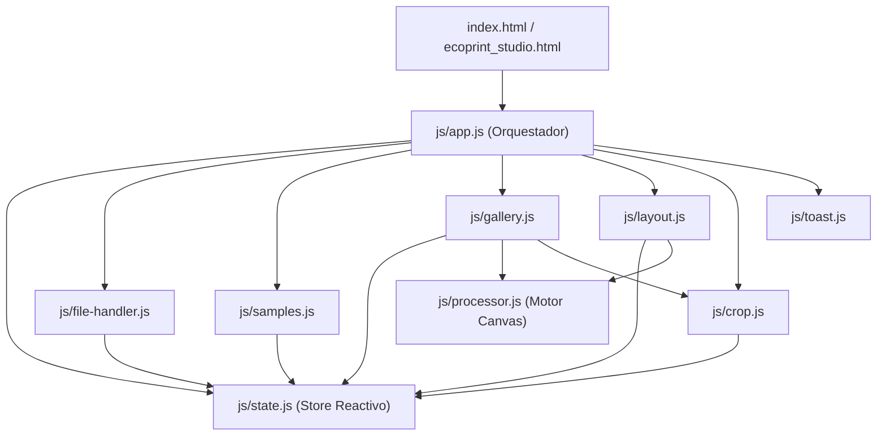

# Informe Técnico y de Arquitectura: EcoPrint Studio

Este documento presenta el resultado de la revisión integral de estándares y buenas prácticas aplicadas al proyecto **EcoPrint Studio**, junto con la descripción detallada de su estructura de directorios, archivos y el catálogo completo de funciones de cada módulo.

---

## 1. Verificación de Buenas Prácticas y Estándares

Durante la auditoría del código se verificaron y aplicaron los siguientes estándares de ingeniería de software web:

1. **Separación Estricta de Responsabilidades (SoC) y Cero Eventos Inline:**
   - Se eliminaron todos los atributos de eventos en línea (`onclick`, `oninput`, `onchange`) del HTML en [`index.html`](file:///c:/a-prov-disc/all_projects/ide_agents_proj/ecoprint_std/index.html) y [`ecoprint_studio.html`](file:///c:/a-prov-disc/all_projects/ide_agents_proj/ecoprint_std/ecoprint_studio.html).
   - Toda la lógica de eventos se delega mediante `addEventListener` desde los módulos ES6, evitando ejecuciones duplicadas, facilitando el cumplimiento de políticas **CSP (Content Security Policy)** y manteniendo limpio el objeto global `window`.

2. **Seguridad Frontend (Prevención de DOM XSS) y Backend (Path Traversal):**
   - **Frontend ([`js/gallery.js`](file:///c:/a-prov-disc/all_projects/ide_agents_proj/ecoprint_std/js/gallery.js)):** Los nombres de archivo cargados por el usuario se asignan mediante `.textContent` y `.title` en lugar de interpolarse directamente en `innerHTML`, previniendo vulnerabilidades de inyección XSS a través de nombres de archivo maliciosos.
   - **Backend ([`server.js`](file:///c:/a-prov-disc/all_projects/ide_agents_proj/ecoprint_std/server.js)):** Se implementó validación estricta de rutas con `path.resolve()` verificando el prefijo del directorio raíz (`__dirname`), manejo seguro de `decodeURIComponent`, restricción de métodos HTTP (`GET` y `HEAD`) y cabeceras de seguridad (`X-Content-Type-Options: nosniff`, `X-Frame-Options: SAMEORIGIN`).

3. **Optimización de Rendimiento en el DOM y Canvas:**
   - Al arrastrar los controles deslizantes individuales de brillo o contraste en [`js/gallery.js`](file:///c:/a-prov-disc/all_projects/ide_agents_proj/ecoprint_std/js/gallery.js), el estado se actualiza de forma silenciosa (`notify = false`) y se repinta **únicamente el `<canvas>` de la tarjeta afectada** en lugar de destruir y reconstruir toda la cuadrícula del DOM, garantizando fluidez a 60 FPS sin perder el foco del control deslizante.

4. **Accesibilidad Web (WAI-ARIA y HTML Semántico):**
   - Todos los botones cuentan con `type="button"` explícito y atributos `aria-label` o `aria-pressed` según su función.
   - El selector de vistas implementa `role="tablist"` y `role="tab"` con sincronización dinámica de `aria-selected`.
   - El modal de recorte incluye `role="dialog"`, `aria-modal="true"`, `aria-labelledby` y soporte de cierre rápido con la tecla `Escape`.
   - El componente de notificaciones flotantes utiliza `role="status"` y `aria-live="polite"`.

5. **Documentación y Tipado mediante JSDoc:**
   - Todas las funciones exportadas e internas relevantes incluyen bloques de comentarios **JSDoc** detallando su propósito, tipos de parámetros (`@param`) y valores de retorno (`@returns`).

---

## 2. Estructura del Proyecto

```text
ecoprint_std/
├── index.html              # Punto de entrada principal (HTML5 semántico y accesible)
├── ecoprint_studio.html    # Punto de entrada espejo para compatibilidad con rutas previas
├── package.json            # Metadatos del proyecto Node.js y scripts de inicio
├── server.js               # Servidor HTTP estático nativo en Node.js (cero dependencias)
├── .gitignore              # Reglas de exclusión para control de versiones Git
├── README.md               # Guía rápida de inicio y uso
├── INFORME_PROYECTO.md     # Informe técnico de arquitectura, estándares y funciones
├── css/
│   ├── main.css            # Estilos de interfaz, dimensiones de hojas en pantalla y scrollbars
│   └── print.css           # Reglas estrictas @media print y configuración base @page
└── js/
    ├── app.js              # Punto de entrada JS, coordinación de vistas y eventos globales
    ├── state.js            # Almacén de estado centralizado con patrón Pub/Sub
    ├── processor.js        # Motor de procesamiento de imagen en Canvas y filtro Eco-Tinta
    ├── crop.js             # Subsistema interactivo de recorte en Canvas (ratón, táctil y teclado)
    ├── layout.js           # Motor de maquetación de páginas, rejillas e impresión/PDF
    ├── gallery.js          # Renderizado de tarjetas de galería y controles individuales
    ├── file-handler.js     # Carga de archivos locales, Drag & Drop y portapapeles (Ctrl + V)
    ├── samples.js          # Generador de documentos sintéticos de prueba en Canvas
    └── toast.js            # Sistema de notificaciones emergentes (Toast)
```

### Flujo de Datos y Dependencias entre Módulos



---

## 3. Detalle de Archivos y Catálogo de Funciones

### 3.1. Archivos Raíz y Configuración

#### [`index.html`](file:///c:/a-prov-disc/all_projects/ide_agents_proj/ecoprint_std/index.html) y [`ecoprint_studio.html`](file:///c:/a-prov-disc/all_projects/ide_agents_proj/ecoprint_std/ecoprint_studio.html)
Definen la estructura semántica de la aplicación dividida en cinco regiones principales:
- **Barra Superior (`<header>`):** Logotipo, conmutador de vistas (*Galería & Edición* vs. *Hojas Maquetadas*) con contadores dinámicos y botón principal de impresión.
- **Barra de Control Global (`<section>`):** Deslizadores grupales de aclarado y contraste, interruptor del filtro *Eco-Tinta* (*Blanquear Fondo*) y selectores de maquetación (imágenes por hoja, tamaño de papel A4/Carta, orientación, márgenes, ajuste de celda y líneas de corte).
- **Contenedor Principal (`<main>`):** Zona de carga *Drag & Drop*, cuadrícula de tarjetas (`#galleryView`) y contenedor de hojas físicas simuladas (`#sheetsView` / `#printArea`).
- **Modal de Recorte (`#cropModal`):** Superposición interactiva con `<canvas id="cropCanvas">` y selectores de relación de aspecto.
- **Notificación Flotante (`#toastMessage`):** Contenedor accesible para avisos de estado.

#### [`server.js`](file:///c:/a-prov-disc/all_projects/ide_agents_proj/ecoprint_std/server.js)
Servidor HTTP estático construido con módulos nativos de Node.js (`http`, `fs`, `path`, `url`):
- Sirve los módulos ES6 con el tipo MIME requerido (`text/javascript; charset=UTF-8`).
- Valida métodos HTTP permitidos (`GET`, `HEAD`), decodifica rutas de forma segura, bloquea intentos de *Directory Traversal* fuera de `__dirname` e inyecta cabeceras de seguridad.

#### [`package.json`](file:///c:/a-prov-disc/all_projects/ide_agents_proj/ecoprint_std/package.json)
Configura el entorno Node.js con `"type": "module"` y provee los scripts:
- `npm start`: Ejecuta `node server.js`.
- `npm run dev`: Ejecuta `node --watch server.js` para recarga automática del servidor en desarrollo.

---

### 3.2. Hojas de Estilo (`css/`)

#### [`css/main.css`](file:///c:/a-prov-disc/all_projects/ide_agents_proj/ecoprint_std/css/main.css)
- Define la tipografía base (`Inter`).
- Establece las clases de proporción física en milímetros para la vista previa en pantalla: `.sheet-a4-portrait` ($210 \times 297\text{ mm}$), `.sheet-a4-landscape` ($297 \times 210\text{ mm}$), `.sheet-letter-portrait` ($215.9 \times 279.4\text{ mm}$) y `.sheet-letter-landscape` ($279.4 \times 215.9\text{ mm}$).
- Configura barras de desplazamiento personalizadas y `touch-action: none` en `#cropCanvas` para evitar desplazamientos accidentales en pantallas táctiles durante el recorte.

#### [`css/print.css`](file:///c:/a-prov-disc/all_projects/ide_agents_proj/ecoprint_std/css/print.css)
- Define la regla `@page` base y el bloque `@media print`.
- Oculta cualquier elemento de interfaz con la clase `.no-print`.
- Fuerza fondo blanco puro (`#ffffff`), ajuste exacto de color (`print-color-adjust: exact`) y saltos de página estrictos (`page-break-after: always; break-after: page`) en cada `.print-sheet`.

---

### 3.3. Módulos JavaScript (`js/`)

#### 1. [`js/state.js`](file:///c:/a-prov-disc/all_projects/ide_agents_proj/ecoprint_std/js/state.js) — Gestión del Estado Central
Almacena el estado único de la aplicación (`state.images`, `state.currentView`, `state.editingItemIndex`) y coordina las notificaciones a la interfaz.

| Función | Parámetros | Descripción |
| :--- | :--- | :--- |
| [`subscribeState`](file:///c:/a-prov-disc/all_projects/ide_agents_proj/ecoprint_std/js/state.js#L18-L21) | `fn: Function` | Registra un suscriptor que se ejecuta cuando cambia el estado y retorna una función para cancelar la suscripción. |
| [`notifyStateChange`](file:///c:/a-prov-disc/all_projects/ide_agents_proj/ecoprint_std/js/state.js#L26-L34) | Ninguno | Invoca de forma segura todos los callbacks suscritos pasando el objeto `state`. |
| [`getImages`](file:///c:/a-prov-disc/all_projects/ide_agents_proj/ecoprint_std/js/state.js#L40-L42) | Ninguno | Retorna el arreglo actual de objetos de imagen cargados. |
| [`addImages`](file:///c:/a-prov-disc/all_projects/ide_agents_proj/ecoprint_std/js/state.js#L48-L52) | `items: Array\|Object` | Inserta una o múltiples imágenes en el estado y dispara `notifyStateChange()`. |
| [`removeImage`](file:///c:/a-prov-disc/all_projects/ide_agents_proj/ecoprint_std/js/state.js#L58-L63) | `index: number` | Elimina la imagen en la posición indicada y actualiza los suscriptores. |
| [`clearAllImagesState`](file:///c:/a-prov-disc/all_projects/ide_agents_proj/ecoprint_std/js/state.js#L68-L71) | Ninguno | Vacía por completo el arreglo de imágenes y notifica el cambio. |
| [`moveImageOrderState`](file:///c:/a-prov-disc/all_projects/ide_agents_proj/ecoprint_std/js/state.js#L78-L85) | `index: number`, `direction: number` | Intercambia la posición de una imagen con su vecina anterior (`-1`) o siguiente (`+1`). |
| [`updateImageProps`](file:///c:/a-prov-disc/all_projects/ide_agents_proj/ecoprint_std/js/state.js#L93-L100) | `index: number`, `props: Object`, `notify?: boolean` | Actualiza propiedades de una imagen específica; permite omitir el repintado global (`notify = false`) durante ajustes en tiempo real. |
| [`applyGlobalAdjustmentsState`](file:///c:/a-prov-disc/all_projects/ide_agents_proj/ecoprint_std/js/state.js#L106-L113) | `{ brightness, contrast, inkSaver }` | Aplica valores de brillo, contraste y ahorro de tinta en lote a todas las imágenes. |
| [`setCurrentView`](file:///c:/a-prov-disc/all_projects/ide_agents_proj/ecoprint_std/js/state.js#L119-L122) | `view: 'gallery'\|'sheets'` | Actualiza la vista activa y notifica a la interfaz. |
| [`setEditingItemIndex`](file:///c:/a-prov-disc/all_projects/ide_agents_proj/ecoprint_std/js/state.js#L128-L130) | `idx: number\|null` | Define qué imagen se encuentra abierta en el modal de recorte. |
| [`getEditingItemIndex`](file:///c:/a-prov-disc/all_projects/ide_agents_proj/ecoprint_std/js/state.js#L136-L138) | Ninguno | Retorna el índice de la imagen actualmente en recorte o `null`. |

---

#### 2. [`js/processor.js`](file:///c:/a-prov-disc/all_projects/ide_agents_proj/ecoprint_std/js/processor.js) — Motor de Procesamiento Gráfico y Ahorro de Tinta
Contiene el pipeline matemático de transformación geométrica y filtrado pixel a pixel sobre HTML5 Canvas.

| Función | Parámetros | Descripción |
| :--- | :--- | :--- |
| [`renderProcessedImageToCanvas`](file:///c:/a-prov-disc/all_projects/ide_agents_proj/ecoprint_std/js/processor.js#L11-L97) | `item: Object`, `targetCanvas: HTMLCanvasElement`, `maxResolution?: number` | Extrae la región recortada (`item.crop`), aplica rotación ($0^\circ, 90^\circ, 180^\circ, 270^\circ$), escala la resolución máxima (`400px` para miniaturas, `1800px` para impresión) y procesa cada píxel aplicando:<br>1. **Factor de Contraste:** $F = \frac{259(C + 255)}{255(259 - C)}$<br>2. **Desplazamiento de Brillo:** $+\Delta B$<br>3. **Filtro Eco-Tinta:** Calcula la luminancia percibida ($Y = 0.299R + 0.587G + 0.114B$) y, si supera el umbral (`215`), convierte el píxel en blanco puro (`255, 255, 255`) para eliminar fondos grises de escaneos o fotos. |

---

#### 3. [`js/crop.js`](file:///c:/a-prov-disc/all_projects/ide_agents_proj/ecoprint_std/js/crop.js) — Herramienta Interactiva de Recorte
Gestiona el modal de recorte, el renderizado de la máscara superpuesta con regla de los tercios y la detección de colisiones de las 8 manijas de redimensionado.

| Función | Parámetros | Descripción |
| :--- | :--- | :--- |
| [`openCropModal`](file:///c:/a-prov-disc/all_projects/ide_agents_proj/ecoprint_std/js/crop.js#L18-L35) | `index: number` | Carga las coordenadas de recorte de la imagen seleccionada, abre el modal e inicializa el canvas interactivo. |
| [`closeCropModal`](file:///c:/a-prov-disc/all_projects/ide_agents_proj/ecoprint_std/js/crop.js#L40-L46) | Ninguno | Oculta el modal de recorte y limpia el índice de edición activo. |
| [`resetCurrentCrop`](file:///c:/a-prov-disc/all_projects/ide_agents_proj/ecoprint_std/js/crop.js#L51-L54) | Ninguno | Restablece el área de recorte al tamaño original completo (`x: 0, y: 0, w: 1, h: 1`). |
| [`confirmCrop`](file:///c:/a-prov-disc/all_projects/ide_agents_proj/ecoprint_std/js/crop.js#L59-L66) | Ninguno | Guarda el recuadro de recorte normalizado en la imagen correspondiente y cierra el modal. |
| [`setCropAspect`](file:///c:/a-prov-disc/all_projects/ide_agents_proj/ecoprint_std/js/crop.js#L72-L90) | `aspect: 'free'\|'1:1'\|'4:3'\|'a4'` | Ajusta el recuadro de recorte a una proporción libre, cuadrada, 4:3 o estándar ISO A4 ($1:\sqrt{2}$). |
| [`applyTargetAspect`](file:///c:/a-prov-disc/all_projects/ide_agents_proj/ecoprint_std/js/crop.js#L98-L110) | `targetRatio: number`, `imgW: number`, `imgH: number` | Función interna que recalcula `w` y `h` normalizados respetando los límites `[0.1, 1.0]` de la imagen. |
| [`updateAspectButtonsUI`](file:///c:/a-prov-disc/all_projects/ide_agents_proj/ecoprint_std/js/crop.js#L115-L125) | Ninguno | Actualiza las clases visuales y el atributo `aria-pressed` de los botones de proporción. |
| [`initCropCanvas`](file:///c:/a-prov-disc/all_projects/ide_agents_proj/ecoprint_std/js/crop.js#L130-L150) | Ninguno | Dimensiona el `<canvas>` de recorte ajustándolo proporcionalmente al contenedor disponible. |
| [`drawCropCanvas`](file:///c:/a-prov-disc/all_projects/ide_agents_proj/ecoprint_std/js/crop.js#L155-L216) | Ninguno | Dibuja la imagen de fondo, la máscara oscura exterior, el área activa recortada, las líneas de tercios y las 8 manijas (`nw`, `ne`, `se`, `sw`, `n`, `s`, `e`, `w`). |
| [`getCropHandlesPixels`](file:///c:/a-prov-disc/all_projects/ide_agents_proj/ecoprint_std/js/crop.js#L225-L236) | `bx, by, bw, bh` | Devuelve un mapa con las coordenadas en píxeles de los 8 puntos de control del recuadro. |
| [`setupCropCanvasEvents`](file:///c:/a-prov-disc/all_projects/ide_agents_proj/ecoprint_std/js/crop.js#L241-L364) | Ninguno | Registra los eventos de ratón (`mousedown`, `mousemove`, `mouseup`), eventos táctiles (`touchstart`, `touchmove`, `touchend`) y teclado (`Escape`). |

---

#### 4. [`js/layout.js`](file:///c:/a-prov-disc/all_projects/ide_agents_proj/ecoprint_std/js/layout.js) — Maquetación de Hojas e Impresión
Calcula la distribución espacial de las imágenes en hojas físicas y prepara el documento para la impresora o generador de PDF del navegador.

| Función | Parámetros | Descripción |
| :--- | :--- | :--- |
| [`getGridSpecs`](file:///c:/a-prov-disc/all_projects/ide_agents_proj/ecoprint_std/js/layout.js#L13-L34) | Ninguno | Retorna `{ cols, rows, perPage }` según el diseño elegido (`1`, `2v`, `2h`, `4`, `6` u `8` imágenes por hoja). |
| [`updatePrintStyles`](file:///c:/a-prov-disc/all_projects/ide_agents_proj/ecoprint_std/js/layout.js#L39-L59) | Ninguno | Inyecta dinámicamente en `<head>` la regla `@page { size: ...; margin: ...; }` acorde al papel, orientación y margen seleccionados. |
| [`updatePageCountEstimate`](file:///c:/a-prov-disc/all_projects/ide_agents_proj/ecoprint_std/js/layout.js#L64-L72) | Ninguno | Calcula el total de páginas requeridas ($\lceil \text{imágenes} / \text{porHoja} \rceil$) y actualiza `#pageCountBadge`. |
| [`renderPrintSheets`](file:///c:/a-prov-disc/all_projects/ide_agents_proj/ecoprint_std/js/layout.js#L77-L152) | Ninguno | Construye en `#printArea` las hojas `.print-sheet`, organiza las celdas CSS Grid, renderiza cada imagen a alta resolución (`1800px`) y añade guías de corte punteadas si están activas. |
| [`triggerPrint`](file:///c:/a-prov-disc/all_projects/ide_agents_proj/ecoprint_std/js/layout.js#L157-L173) | Ninguno | Verifica que existan imágenes cargadas, fuerza la actualización de las hojas maquetadas e invoca `window.print()`. |

---

#### 5. [`js/gallery.js`](file:///c:/a-prov-disc/all_projects/ide_agents_proj/ecoprint_std/js/gallery.js) — Renderizado y Control de Galería Individual
Genera las tarjetas interactivas de la vista de galería y gestiona las ediciones individuales de cada imagen.

| Función | Parámetros | Descripción |
| :--- | :--- | :--- |
| [`renderGalleryCards`](file:///c:/a-prov-disc/all_projects/ide_agents_proj/ecoprint_std/js/gallery.js#L13-L152) | Ninguno | Construye las tarjetas en `#imageCardsGrid` con su miniatura Canvas (`400px`), insignias de estado (*Recortada*, rotación, *Eco-Tinta*), deslizadores individuales y botones de acción. |
| [`updateIndividualBrightness`](file:///c:/a-prov-disc/all_projects/ide_agents_proj/ecoprint_std/js/gallery.js#L160-L162) | `index: number`, `val: number\|string`, `reRenderAll?: boolean` | Actualiza el brillo de la imagen indicada en el estado. |
| [`updateIndividualContrast`](file:///c:/a-prov-disc/all_projects/ide_agents_proj/ecoprint_std/js/gallery.js#L170-L172) | `index: number`, `val: number\|string`, `reRenderAll?: boolean` | Actualiza el contraste de la imagen indicada en el estado. |
| [`rotateImage`](file:///c:/a-prov-disc/all_projects/ide_agents_proj/ecoprint_std/js/gallery.js#L178-L184) | `index: number` | Rota la imagen $90^\circ$ en sentido horario ($(R + 90) \bmod 360$) y muestra una notificación. |
| [`deleteImage`](file:///c:/a-prov-disc/all_projects/ide_agents_proj/ecoprint_std/js/gallery.js#L190-L193) | `index: number` | Elimina la imagen seleccionada del estado y notifica al usuario. |
| [`moveImageOrder`](file:///c:/a-prov-disc/all_projects/ide_agents_proj/ecoprint_std/js/gallery.js#L200-L202) | `index: number`, `direction: number` | Desplaza la imagen una posición hacia atrás (`-1`) o hacia adelante (`+1`). |

---

#### 6. [`js/file-handler.js`](file:///c:/a-prov-disc/all_projects/ide_agents_proj/ecoprint_std/js/file-handler.js) — Carga de Archivos y Portapapeles
Gestiona todas las vías de entrada de imágenes del usuario.

| Función | Parámetros | Descripción |
| :--- | :--- | :--- |
| [`setupDropZone`](file:///c:/a-prov-disc/all_projects/ide_agents_proj/ecoprint_std/js/file-handler.js#L14-L54) | Ninguno | Configura los eventos de arrastrar y soltar (`dragenter`, `dragover`, `dragleave`, `drop`) y el clic sobre `#dropZone` para abrir el selector de archivos. |
| [`setupPasteSupport`](file:///c:/a-prov-disc/all_projects/ide_agents_proj/ecoprint_std/js/file-handler.js#L59-L79) | Ninguno | Escucha el evento global `paste` (`Ctrl + V`) para capturar imágenes directamente desde el portapapeles. |
| [`handleIncomingFiles`](file:///c:/a-prov-disc/all_projects/ide_agents_proj/ecoprint_std/js/file-handler.js#L85-L129) | `fileList: FileList\|File[]` | Filtra archivos con tipo MIME `image/*`, los decodifica de forma asíncrona e inicializa sus parámetros con los valores globales activos. |
| [`loadImageFromFile`](file:///c:/a-prov-disc/all_projects/ide_agents_proj/ecoprint_std/js/file-handler.js#L136-L147) | `file: File` | Envuelve `FileReader` y `new Image()` en una `Promise<HTMLImageElement>` para carga asíncrona. |

---

#### 7. [`js/samples.js`](file:///c:/a-prov-disc/all_projects/ide_agents_proj/ecoprint_std/js/samples.js) — Generador de Documentos de Prueba
Permite probar todas las funciones del sistema sin necesidad de subir archivos externos.

| Función | Parámetros | Descripción |
| :--- | :--- | :--- |
| [`loadSampleImages`](file:///c:/a-prov-disc/all_projects/ide_agents_proj/ecoprint_std/js/samples.js#L12-L108) | `e?: Event` | Genera dinámicamente en memoria 4 documentos sintéticos (factura escaneada, diagrama de red, apuntes con sombras y reporte estadístico) con fondos grises para demostrar el efecto del filtro *Eco-Tinta*. |

---

#### 8. [`js/toast.js`](file:///c:/a-prov-disc/all_projects/ide_agents_proj/ecoprint_std/js/toast.js) — Notificaciones Flotantes
Provee retroalimentación visual inmediata sin bloquear el hilo principal.

| Función | Parámetros | Descripción |
| :--- | :--- | :--- |
| [`showToast`](file:///c:/a-prov-disc/all_projects/ide_agents_proj/ecoprint_std/js/toast.js#L12-L29) | `message: string`, `isError?: boolean` | Muestra el banner flotante inferior derecho durante 3.5 segundos con icono de éxito (`✓`) o advertencia (`⚠️`). |

---

#### 9. [`js/app.js`](file:///c:/a-prov-disc/all_projects/ide_agents_proj/ecoprint_std/js/app.js) — Orquestador Principal
Conecta el estado central con los módulos de interfaz y vincula todos los eventos del DOM al iniciar la aplicación.

| Función | Parámetros | Descripción |
| :--- | :--- | :--- |
| [`updateUI`](file:///c:/a-prov-disc/all_projects/ide_agents_proj/ecoprint_std/js/app.js#L35-L53) | Ninguno | Actualiza contadores, visibilidad de mensajes vacíos y delega el renderizado a la vista activa (`renderGalleryCards` o `renderPrintSheets`). |
| [`switchView`](file:///c:/a-prov-disc/all_projects/ide_agents_proj/ecoprint_std/js/app.js#L59-L90) | `view: 'gallery'\|'sheets'` | Conmuta clases visuales, atributos `aria-selected`, visibilidad de secciones y actualiza `state.currentView`. |
| [`clearAllImages`](file:///c:/a-prov-disc/all_projects/ide_agents_proj/ecoprint_std/js/app.js#L96-L102) | `e?: Event` | Limpia todas las imágenes del estado y notifica al usuario. |
| [`updateGlobalBrightnessLabel`](file:///c:/a-prov-disc/all_projects/ide_agents_proj/ecoprint_std/js/app.js#L108-L111) | `val: number\|string` | Refresca el indicador porcentual de brillo global (`+30%`). |
| [`updateGlobalContrastLabel`](file:///c:/a-prov-disc/all_projects/ide_agents_proj/ecoprint_std/js/app.js#L117-L121) | `val: number\|string` | Refresca el indicador porcentual de contraste global (`+10%`). |
| [`applyGlobalAdjustmentsToAll`](file:///c:/a-prov-disc/all_projects/ide_agents_proj/ecoprint_std/js/app.js#L126-L139) | Ninguno | Toma los valores actuales de la barra global y los aplica a todas las imágenes cargadas. |
| [`onLayoutChange`](file:///c:/a-prov-disc/all_projects/ide_agents_proj/ecoprint_std/js/app.js#L144-L150) | Ninguno | Recalcula las reglas `@page`, el estimado de hojas y repinta la vista de hojas si está activa. |
| [`initApp`](file:///c:/a-prov-disc/all_projects/ide_agents_proj/ecoprint_std/js/app.js#L155-L210) | Ninguno | Inicializa todos los subsistemas, registra el suscriptor principal en `state.js` y asocia todos los eventos del DOM mediante `addEventListener`. |
